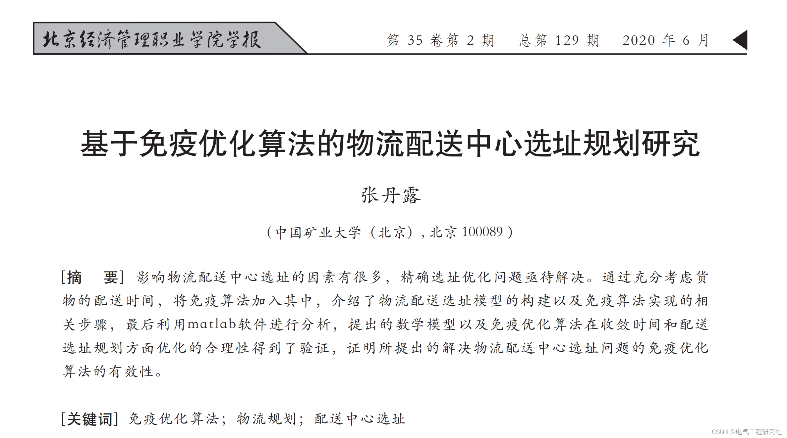
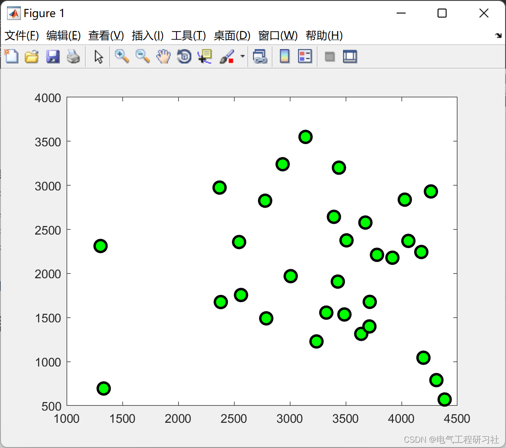
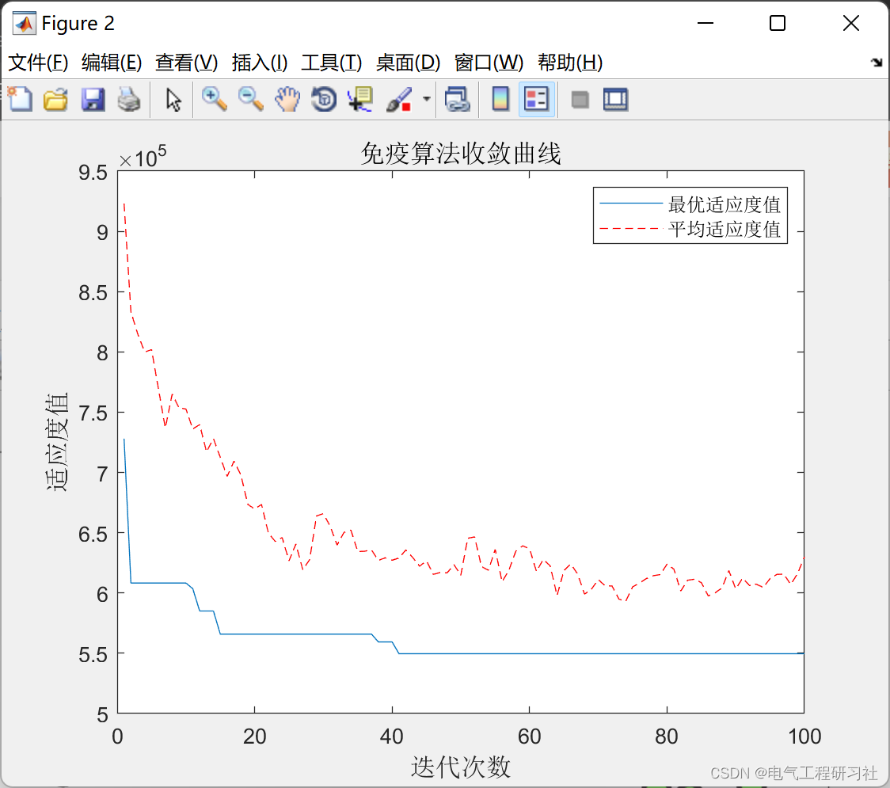
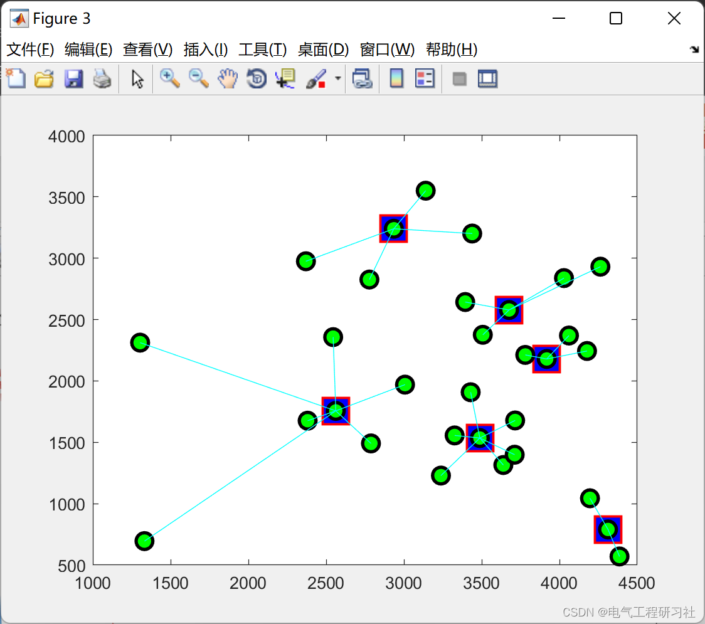

# Research on the Location Planning of Logistics and Distribution Center Based on Immunized Optimization Algorithm (Matlab Implementation)

💥💥💥💞💞💞💞 Welcome to this blog❤️❤️❤️💥💥💥
🎉🎉 Welcome to your arrival 🎉🎉
📚📚📚📋Column Directory: The Beauty of Power Systems and Algorithms👨‍💻👨‍💻👨‍💻

​​​​​​​​​​​​​​​​​​​​​​​​​​​​​​​​​​​​​​​​​​​​​​​​​​​​​​​​​​​​​​​​​​​​​​​​​​​​​​​​​​​​​​​​​​​​​​​​​​​​​​​​​​​​​​​​​​​​​​​​​​​​​​​​​​​​​​​​​​​​​​​​​​​​​​​​It is recommended that readers browse the catalog in order, to avoid being suddenly plunged into a dark labyrinth without knowing how to return. It may not reveal all the answers to you, but it can certainly raise a multitude of doubts within your mind, which might lead to a different landscape of sunsets with colorful hues. If it brings you a heavy rain in the spiritual world, then take this opportunity to wash away the dust from the "truth" that was previously stored there. Perhaps, after the rain subsides and clouds clear up, the sky and earth will become even more clear...🔎🔎🔎
📋📋📋This article is organized as follows: ⛳️⛳️⛳️Table of Contents 1. Overview 2. Explanation of the Article 3. Running Results 4. MATLAB Code Implementation 5. Final Thoughts
It rapidly promoted the new development of logistics industry. "The logistics industry plays an important role in the development of our country's economy. The development of the logistics industry has expanded regional employment capacity. Optimizing the regional industrial structure can reduce the cost of logistics industry. The modern logistics industry has become an important part of the modern service industry. One of the main research directions in the field of logistics industry is how to integrate potential issues that may arise during the logistics transportation process. According to the development trend of the logistics industry, Distribution center is the link between distributors and A critical link between retailers and customers. Considering all factors comprehensively and making reasonable planning of the distribution center location is particularly important. The location planning of logistics distribution center has been widely concerned in academia.
Logistics is the process of transporting goods from warehouses to destinations. Including various basic functions such as loading and unloading, Handling, Transportation Distribution, Processing, etc. The process of transporting goods from the place of production to the place of demand. A central site is required for the centralized distribution of goods. The purpose of establishing a central site is to enable the efficient and expedited delivery of goods to their destination. This central site is the logistics distribution center. Logistics distribution center site selection is influenced by the distribution of materials. Due to factors such as transportation and other circumstances. Considering various factors, the rational planning of the specific location of distribution centers plays a crucial role in the development of the logistics industry. 4 The focus of this paper is to construct a mathematical model. Utilize intelligent software to scientifically plan the location of logistics distribution centers.
2. There are many factors that affect the location selection of logistics distribution centers in this paper. The problem of precise site selection optimization is urgently needed to be solved. By fully considering the delivery of goods.
In the interim, an immune algorithm was incorporated into the model. The construction of the logistics distribution location selection model and the implementation steps of the immune algorithm were introduced. Finally,
Analyzed with MATLAB software, the mathematical model and immune optimization algorithm are optimized in terms of convergence time and distribution location planning.
The rationality has been verified, proving the effectiveness of the immune optimization algorithm proposed to solve the problem of locating logistics distribution centers.
For more detailed information, see:
​  
3. Running results
​  
​  
4. MATLAB code implementation
% Draw the distribution center location map\n% Draw the distribution center\ncargox=bestchrom([1,3,5,7]);\ncargoy=bestchrom([2,4,6,8]);\n\nplot(cargox,cargoy,'rs','LineWidth',2,...\n    'MarkerEdgeColor','r',...\n    'MarkerFaceColor','b',...\n    'MarkerSize',10)\nhold on\n\n% Draw the requirement points\nplot(suplocationx,suplocationy,'o','LineWidth',2,...\n    'MarkerEdgeColor','k',...\n    'MarkerFaceColor','g',...\n    'MarkerSize',10)\nhold on\n\n% Connected graph\ncarlocationx=bestchrom([1,3,5,7]);\ncarlocationy=bestchrom([2,4,6,8]);\nfor i=9:128\n    \n    superindex=fix((i-8)/6)+1;  % Requirement Points\n    if superindex==21\n        superindex=20;\n    end\n    k=mod((i-8),6);\n    cargoindex=bestchrom(i);   % Distribution Center\n    \n    x=[suplocationx(superindex),carlocationx(cargoindex)];\n    y=[suplocationy(superindex),carlocationy(cargoindex)];\n    switch k\n        case 0;plot(x,y,'c');hold on\n        case 1;plot(x,y,'r');hold on\n        case 2;plot(x,y,'y');hold on\n        case 3;plot(x,y,'b');hold on\n        case 4;plot(x,y,'g');hold on\n        case 5;plot(x,y,'m');hold on\n    end  \nend\n5 End of the text, theoretical references to online literature, if there is any infringement, please contact the blogger to delete.。  

## Images

<!-- PAYMENT_BLOCK -->

## Get this dataset

- Payment link (Stripe): [Buy now](https://buy.stripe.com/3cs8yP7sY87d0vu9AB)
- Payment QR code: 

<!-- /PAYMENT_BLOCK -->
